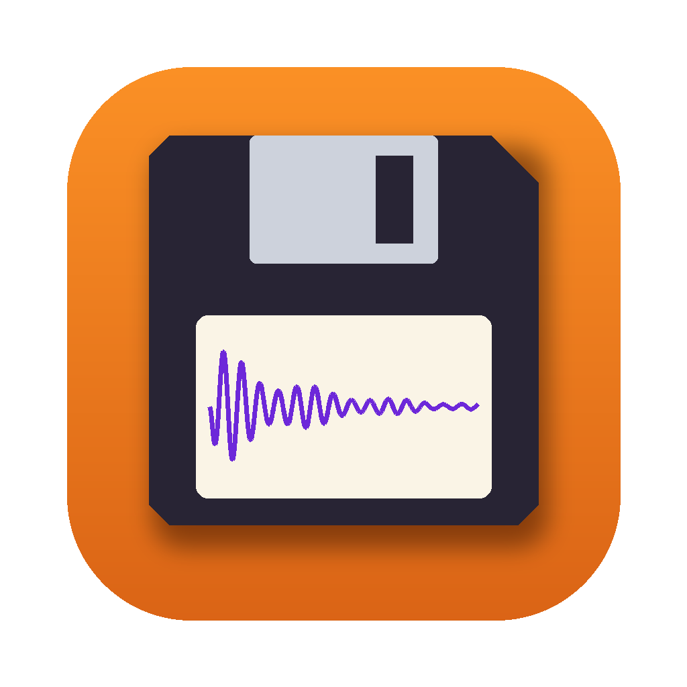

# Floppy Blaster



Move samples on and off Akai and MPC2000XL floppy disk images, listen to them, and make programs from them, on a Mac. By Ed Davis.

Floppy Blaster is MPC Blaster's sibling for floppy emulators. It works with the `.img` files that a Gotek running FlashFloppy loads into a sampler: 1.6 MB Akai S1000/S3000-format disks and 1.44 MB MPC2000XL (DOS) disks. It makes simple programs; detailed editing of programs and sampler settings is left to [S-Control](https://github.com/Ed-Davis/S-Control).

## What it does

- **Finds your floppy images.** Plug in the Gotek's USB stick and it's found by its `FF.CFG` file, or choose any folder. Disks are listed by folder, as FlashFloppy shows them.
- **Shows what's on a disk:** names, file types, sample rates, lengths, free space and the disk's name on the sampler.
- **Plays samples.** Use the play button, double-click, or Space.
- **Adds audio.** Drop WAV, AIFF, MP3, M4A or FLAC files on a disk. They're converted to 16-bit Akai samples at 44.1 or 22.05 kHz. Stereo becomes a "NAME -L" / "NAME -R" pair (Akai's own convention) or is mixed to mono.
- **Exports** samples as WAV, or any file as a raw Akai file (`.s3`, `.p1`…; hold Option). Raw files can be added back later.
- **Renames and deletes** files, and renames the disk.
- **Make Program (Akai)** makes a program that plays the chosen samples one per key from C1 (MIDI 36) up, each at its recorded pitch, like a drum kit. Stereo `-L`/`-R` pairs share a key, panned. Up to 92 keys (C1–G8). The program gets the first program number no other program on the disk uses. On an Akai, the disk itself is the "all programs and sounds" bundle: load the entire volume.
- **MPC2000XL floppies** open like Akai ones. Audio dropped on them becomes `.SND` sounds; `.PGM`, `.APS` and other files are copied as they are. **Make Program** puts sounds on pads A01…D16 of a new `.PGM` (up to 64), and **Make APS** bundles programs and every sound they use. Both check the sounds fit in the MPC's sample memory (2, 16 or 32 MB). The windows show each sound's exact 8-character name on the MPC, with ⚠︎ where it's shortened or numbered, and limit program names to 16 characters (12 for Akai programs), showing how they'll appear.
- **New Blank Disk** makes a freshly formatted S3000, S1000 or MPC2000XL disk, numbered `001.img`, `002.img`… in the selected folder.

## Formats

| | S1000 format | S3000 format |
|---|---|---|
| Samplers | S1000, S1100, S01 | S2000, S2800, S3000, S3200 |
| Files per disk | 64 | 512 |
| Space | 1,595 KB | 1,583 KB |

MPC2000XL floppies are standard 1.44 MB DOS disks (FAT12, 224 root entries, 1,423 KB of space).

Floppy Blaster detects the format itself. S900/S950 disks use a different format and aren't supported.

## Safe saving

Every change is written straight to the image. The new image goes into a hidden temporary file beside the old one and is flushed to the stick. Only then is it swapped in, so a pulled stick can't leave a half-written disk. A change that won't fit is refused before anything is written.

## How the format works

Each image is 1600 blocks of 1 KB:

```
0x0000  64 directory entries × 24 bytes (S1000)
        or "MULTI FILE" placeholders (S3000)
0x0600  block table, 2 bytes per block
        0 = free, 0x4000 = system, 0xC000 = last block of a file,
        otherwise the next block
0x1280  disk name (12 Akai characters) and settings
0x1400  512 directory entries (S3000 only)
```

A directory entry holds:

- the name (12 characters)
- 4 tag bytes
- the type: `s`/`p`/`x`… (0x73, 0x70, 0x78…), with the top bit set for S3000 files
- the size (3 bytes)
- the first block
- the OS version

A sample is a header followed by 16-bit little-endian mono audio. The header is 150 bytes for S1000 files and 192 bytes for S3000 files.

`Scripts/akaidisk.py` is a small reference implementation of the format. It was checked against disks made by real S1000, S1100, S01, S2000, S2800 and S3000 samplers. It also generates the test fixtures, and the Swift tests require the app to write byte-identical disks.

## Akai programs

A program file is a program header followed by one keygroup per key, all 150 bytes (S1000, type `0x70`) or 192 bytes (S3000, `0xF0`). New programs copy every setting from drum-kit programs on Akai's own factory disks (S1000 *Workstation 2 Funk*, S3000 *SL3007 Ambience Kit*) and change only:

- program: name (3–14), program number (15), MIDI channel 1 (16), keygroup count (42)
- each keygroup: low and high note (3, 4) both the key, tuning 0, zone 1 (and zone 2 for a stereo pair) set to the sample name with velocity 0–127, the other zones empty, and "constant pitch" on (132–135) so samples play at their recorded pitch

## MPC2000XL files

The FAT12, `.PGM`, `.APS` and `.SND` code is shared with MPC Blaster 3, where the `.PGM` writer rebuilds a program saved by an MPC2000XL byte for byte. MPC floppy changes are made to a copy of the image in memory and saved the same safe way as Akai disks. The tests check the results with macOS's own `fsck_msdos`.

## Building

- `swift test` runs the tests.
- `./make-dmg.sh` builds `build/Floppy Blaster.app` and a test DMG. It's ad-hoc signed; set `SIGN_IDENTITY` to sign with your Developer ID.
- CI builds, tests and uploads the DMG as **FloppyBlaster-test-dmg** on every push.

```
Sources/FloppyBlasterCore/  Akai disk format, samples, programs, audio import, saving
  MPC/                      MPC2000XL floppies: FAT12, .SND, .PGM, .APS
Sources/FloppyBlaster/      The SwiftUI app
Tests/                      Format and import tests, with generated fixture disks
Scripts/akaidisk.py         Reference implementation and fixture generator
```

© 2026 Ed Davis. Not affiliated with Akai Professional, inMusic, or the makers of FlashFloppy or Gotek.
